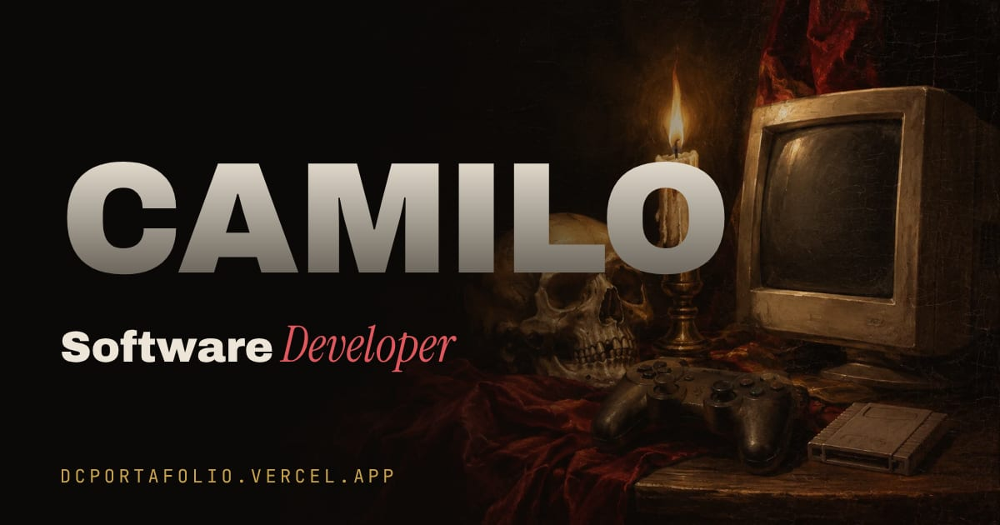
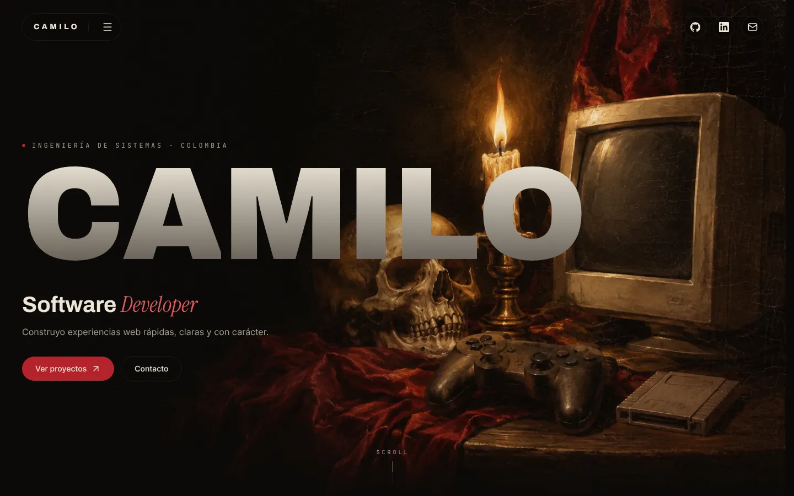
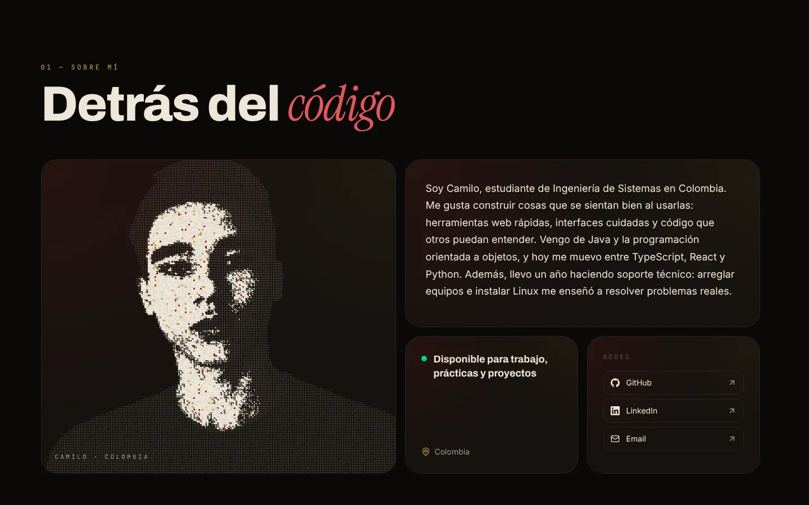
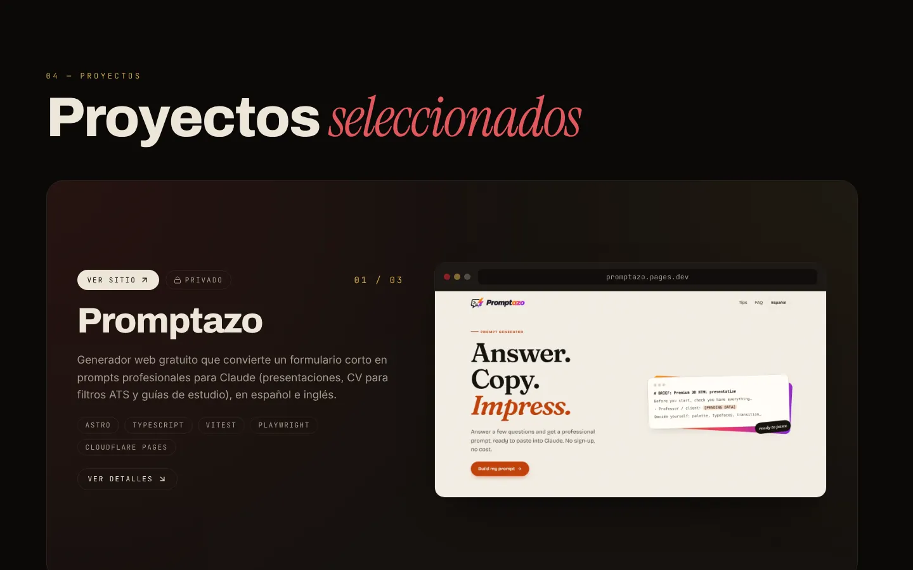
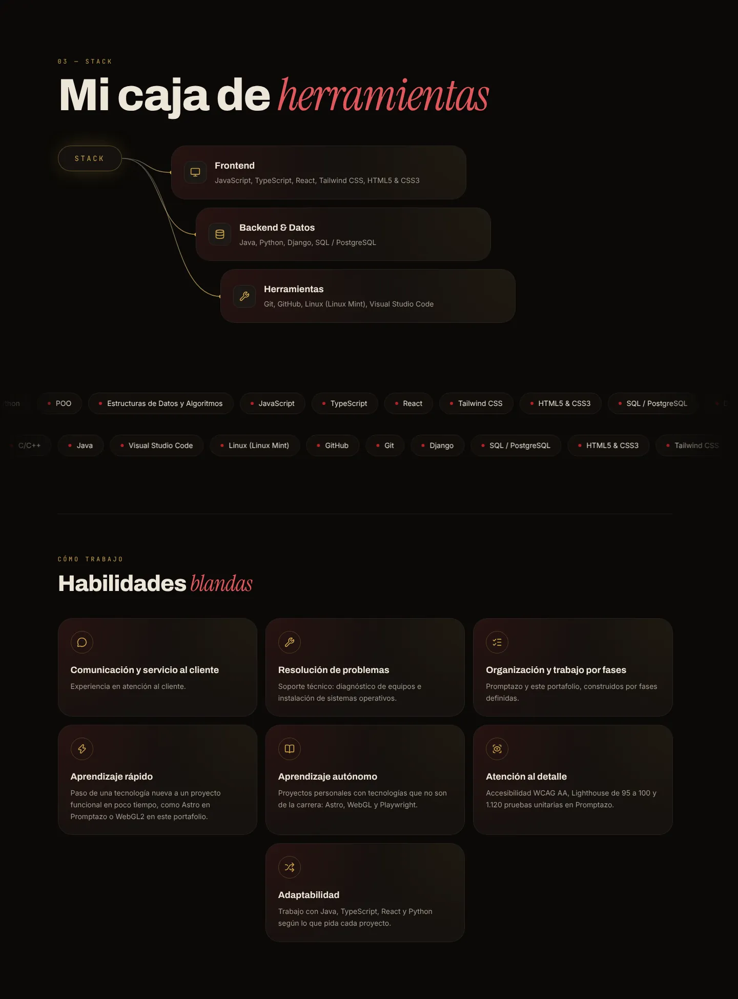
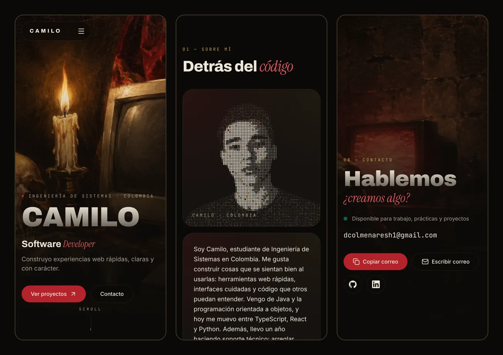

<p align="center">
  
</p>

<h1 align="center">Camilo Colmenares · Portafolio</h1>

<p align="center">
  <strong>Software Developer · Estudiante de Ingeniería de Sistemas</strong>
</p>

<p align="center">
  <a href="https://dcportafolio.vercel.app">Ver sitio</a> ·
  <a href="https://www.linkedin.com/in/camilo-colmenares-7b96a6281">LinkedIn</a> ·
  <a href="https://github.com/Camilo0812A">GitHub</a> ·
  <a href="mailto:dcolmenaresh1@gmail.com">Correo</a>
</p>

<p align="center">
  
  
  
  
  
  
  
  <br>
  
  
  
  
</p>

---

## Sobre el proyecto

Mi portafolio personal parte de una idea: un **claroscuro tipo pintura al óleo** con guiños a la cultura **gamer**. Calavera, vela, control de videojuego y monitor CRT conviven en un mismo bodegón que acompaña todo el recorrido.

El sitio muestra quién soy, mi stack con niveles reales, mis habilidades blandas, los proyectos que he construido y la música que me acompaña, todo con animaciones pensadas para sumar y no estorbar. Está disponible para **trabajo, prácticas y proyectos**.

## Vista previa

<p align="center">
  
</p>

<table>
  <tr>
    <td align="center" valign="top" width="50%">
      <br>
      <sub><b>Sobre mí</b> · retrato de partículas</sub>
    </td>
    <td align="center" valign="top" width="50%">
      <br>
      <sub><b>Proyectos</b> · cards apiladas</sub>
    </td>
  </tr>
  <tr>
    <td align="center" valign="top" width="50%">
      <br>
      <sub><b>Stack</b> · árbol, marquee y habilidades blandas</sub>
    </td>
    <td align="center" valign="top" width="50%">
      <br>
      <sub><b>Móvil</b> · inicio, sobre mí y contacto</sub>
    </td>
  </tr>
</table>

## Características

- **Retrato interactivo de partículas** dibujado con WebGL2 nativo, sin librerías 3D.
- **Cards de proyectos apiladas** que se superponen con el scroll.
- **Revelado de texto** y entradas escalonadas al hacer scroll.
- **Árbol de herramientas animado** y marquee infinito de habilidades con su nivel.
- **Habilidades blandas** con la evidencia que las respalda.
- **Música con portadas**, con un vinilo que sale al pasar el cursor.
- **Accesibilidad**: skip link, foco visible, soporte de `prefers-reduced-motion` y axe sin violaciones.
- **SEO completo**: Open Graph, datos estructurados JSON-LD, sitemap y `robots.txt`.
- **Carga diferida** de las secciones bajo el primer pantallazo para un inicio rápido.

## Rendimiento y accesibilidad

Medido con Lighthouse sobre la compilación de producción (`npm run build` + `npm run preview`).

| Dispositivo | Performance | Accessibility | Best Practices | SEO |
| :---------- | :---------: | :-----------: | :------------: | :-: |
| Móvil       | 99–100      | 100           | 100            | 100 |
| Escritorio  | 99–100      | 100           | 100            | 100 |

## Stack

| Tecnología | Uso |
| :--------- | :-- |
| React 19 + TypeScript | Interfaz y tipado del contenido |
| Vite | Servidor de desarrollo y compilación |
| Tailwind CSS 4 | Estilos y tokens de diseño |
| Motion | Animaciones de entrada, scroll y hover |
| Lenis | Scroll suave |
| WebGL2 | Retrato de partículas |
| Lucide | Iconos |
| Oxlint | Linter |
| Vercel | Despliegue |

## Estructura del proyecto

```text
.
├── docs/
│   └── screenshots/        Capturas usadas en este README
├── public/
│   ├── images/             Arte, retratos, proyectos y portadas
│   ├── og.jpg              Imagen para compartir
│   ├── robots.txt
│   └── sitemap.xml
└── src/
    ├── components/
    │   ├── layout/         Navbar, menú, preloader y footer
    │   ├── sections/       Hero, About, Skills, Projects, Music, Contact…
    │   ├── ui/             Piezas reutilizables (Icon, SectionHeading)
    │   └── effects/        Retrato de partículas en WebGL2
    ├── context/            Contexto de scroll suave
    ├── data/               portfolioData.ts: todo el contenido
    ├── hooks/              useLenis, useMediaQuery
    ├── lib/                Utilidades
    ├── types/              Tipos del contenido
    └── index.css           Tokens de diseño y estilos globales
```

## Cómo correrlo

Requisitos: [Node.js](https://nodejs.org) 22 o superior (Vite 8 pide al menos la 20.19).

```bash
npm install
npm run dev       # servidor de desarrollo
npm run build     # revisa los tipos y genera dist/
npm run preview   # sirve la compilación local
```

## Editar el contenido

Todo el texto, los proyectos, las canciones y los enlaces viven en [`src/data/portfolioData.ts`](src/data/portfolioData.ts); los componentes no llevan contenido propio. Las imágenes van en [`public/images/`](public/images).

Para agregar un proyecto, suma un objeto al arreglo `projects`:

```ts
{
  id: 'mi-proyecto',
  title: 'Mi proyecto',
  description: 'Qué hace y para quién, en una o dos frases.',
  tech: ['React', 'TypeScript'],
  repoUrl: 'https://github.com/Camilo0812A/mi-proyecto',
  liveUrl: 'https://camilo0812a.github.io/mi-proyecto/',
  image: '/images/projects/mi-proyecto.webp',
  featured: false,
  year: 2026,
}
```

## Créditos

- Las portadas de las canciones se cargan desde Spotify, salvo la de *Waltz for Moon*, creada para este sitio.
- El arte de fondo fue creado para este sitio.
- Tipografías de [Google Fonts](https://fonts.google.com): Archivo, Instrument Serif, Inter y JetBrains Mono.
- Iconos de [Lucide](https://lucide.dev).

## Contacto

- Correo: [dcolmenaresh1@gmail.com](mailto:dcolmenaresh1@gmail.com)
- LinkedIn: [Camilo Colmenares](https://www.linkedin.com/in/camilo-colmenares-7b96a6281)

---

<p align="center">
  Hecho por Camilo Colmenares · 2026
</p>
